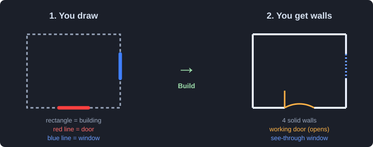
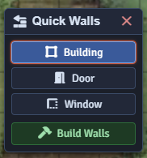

# Quick Walls

**Wall a battlemap in seconds.** Draw rectangles over buildings and quick lines
for doors and windows, then one click turns them into proper walls, working
doors, and see-through windows.

**System-agnostic** — it uses only core Foundry APIs, so it works with any game
system (D&D 5e, PF2e, Pathfinder, a blank world, anything).




---

## Why

Walling a map by hand is slow: switch to the walls layer, trace every segment,
place each door, then do it again on the next scene. Quick Walls flips the work.
You rough out buildings with the drawing tools, which already snap to the grid,
and it does the precise wall-and-door placement for you. You stay focused on the
irregular, hand-crafted areas that actually need your eye.

## Installation

In Foundry: **Add-on Modules → Install Module**, and paste this manifest URL:

```
https://github.com/KingSideKnight/quick-walls/releases/latest/download/module.json
```

Then enable **Quick Walls** in your world's module settings.

## Usage

1. Open the **Walls** controls in the left toolbar and click the **Quick Walls**
   button (trowel icon). A small floating panel opens.

   

2. **Building** — drag a rectangle over each (square) building.
3. **Door** — drag a short line along a wall where a door goes. The line is
   auto-colored red; you never touch the color picker.
4. **Window** — drag a short line for each window (auto-colored blue).

   

5. **Build Walls** — review the counts, confirm, done.

   

Each rectangle becomes four walls. Each door line becomes a **working door** with
a gap left in the wall. Each window line becomes a segment that **blocks movement
but lets sight and light through**. The guide drawings are cleared afterward.

> The line's **length** sets the opening width, and a line only attaches to a
> wall it sits on (within about half a grid square), so draw it **along** the
> wall where the opening should be.

## Settings

| Setting | Default | What it does |
| --- | --- | --- |
| **Door line color** | red | The color used to mark and detect doors. |
| **Window line color** | blue | The color used to mark and detect windows. |
| **Delete guide drawings after building** | on | Clear the rectangles/lines once walls are made. |
| **Windows block sound** | on | Whether windows muffle sound (like glass). |

## API

```js
game.modules.get("quick-walls").api.toggle(); // open/close the panel
game.modules.get("quick-walls").api.build();  // build walls from the current drawings
```

## How it works

Quick Walls reads the drawings on the active scene:

- A **rectangle** becomes the four perimeter walls of a building.
- A **line** on a wall (freehand or polygon, colored as a door or window)
  marks an opening. Quick Walls leaves a gap in the wall there and inserts a
  real door or a see-through window segment, sized to the line.

It then creates the wall documents in one batch. Nothing is placed until you
confirm the preview.

## Limitations

- Buildings are assumed **axis-aligned** (not rotated) — perfect for the common
  square-building case. Rotated or irregular shapes are still best by hand.
- A door/window line must sit **on** the wall it opens (within ~half a grid
  square) to attach.

## Compatibility

Foundry VTT **v13–v14**. No dependencies. No system requirements.

## Issues & contributions

Bug reports and ideas are welcome on the
[issue tracker](https://github.com/KingSideKnight/quick-walls/issues).

## License

[MIT](LICENSE) © KingSideKnight
