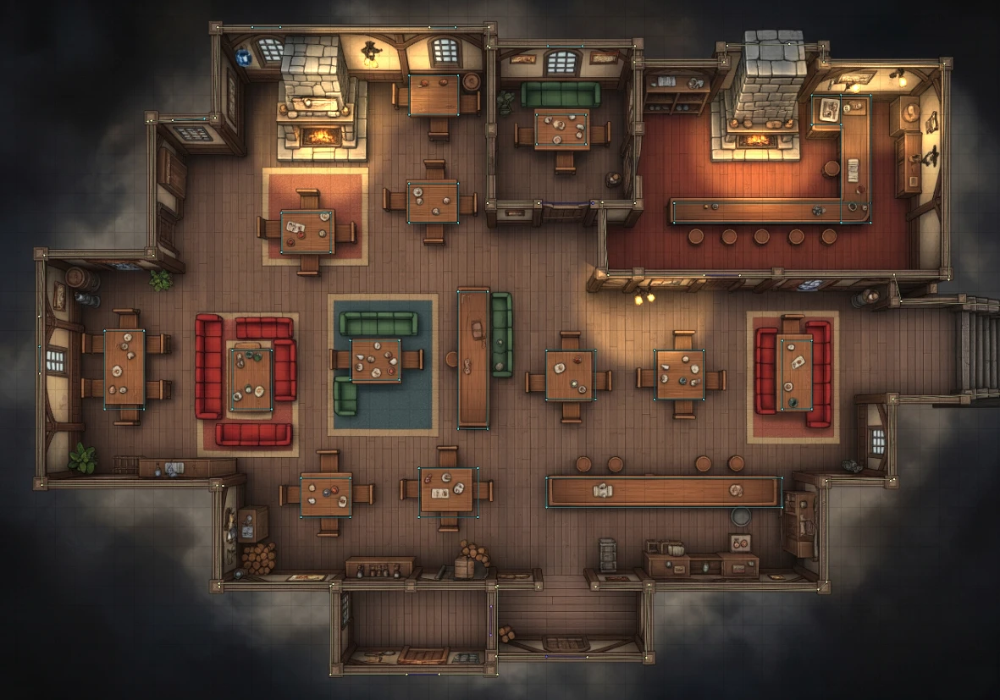
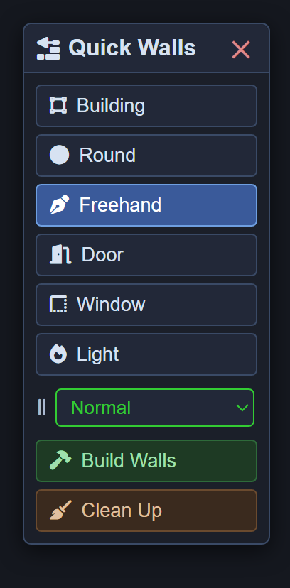
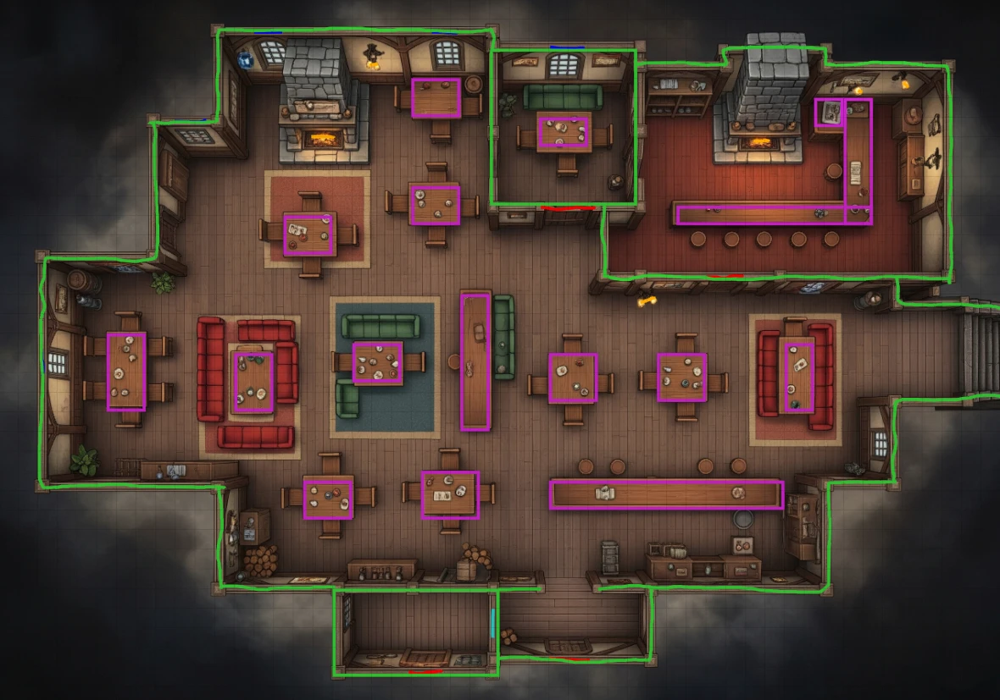

# Quick Walls

**Wall a battlemap in seconds.** Rough out buildings with rectangles, ovals, or
freehand strokes, add quick lines for doors and windows, drop a mark where a
light goes, then one click turns it all into proper walls, working doors,
see-through windows, and ambient lights.

**System-agnostic** — it uses only core Foundry APIs, so it works with any game
system (D&D 5e, PF2e, Pathfinder, a blank world, anything).




---

## Why

Walling a map by hand is slow: switch to the walls layer, trace every segment,
place each door, then do it again on the next scene. Quick Walls flips the work.
You rough out buildings with the drawing tools, which already snap to the grid,
and it does the precise wall-and-door placement for you. You stay focused on the
irregular, hand-crafted areas that actually need your eye.

## Installation

In Foundry: **Add-on Modules → Install Module**, and paste this manifest URL:

```
https://github.com/KingSideKnight/quick-walls/releases/latest/download/module.json
```

Then enable **Quick Walls** in your world's module settings.

## Usage

1. Open the **Walls** controls in the left toolbar and click the **Quick Walls**
   button (trowel icon). A small floating panel opens.
2. **Building** — drag a rectangle over each square building.
3. **Round** — drag an oval or circle over a round tower or room. It becomes a
   closed ring of walls.
4. **Freehand** — trace a curved or irregular wall (a cave edge, a cliff line).
   The stroke is smoothed and turned into wall segments that follow your path;
   draw a closed loop and it closes itself.
5. **Door** — drag a short line along a wall where a door goes. The line is
   auto-colored red; you never touch the color picker.
6. **Window** — drag a short line for each window (auto-colored blue).
7. **Light** — click a mark where a light should sit (auto-colored orange). Each
   mark becomes an ambient light.
8. **Wall type** — pick the Foundry wall type *before* you draw it: Normal,
   Terrain, Invisible, or Ethereal. Each type has its own guide color, so you
   can draw some Normal walls, switch the dropdown to Terrain, draw some more,
   and Build gives each stroke the type it was drawn as. Change the dropdown as
   often as you like in one session.
9. **Build Walls** — review the counts, confirm, done.

Every guide is colored by what it is — doors red, windows blue, lights orange,
and each wall type its own color (Normal green, Terrain yellow, Invisible
magenta, Ethereal cyan) — so you can see at a glance what each stroke will
become, and the opening lines always stand out against the walls.

**Clean Up** (the broom button) is a separate, one-click tidy for the whole
scene — it needs no guides. It finds **zero-length walls** (stray clicks,
collapsed stubs) and **duplicate/overlapping walls**, shows you the counts, and
removes them only after you confirm. A wall is only ever treated as a duplicate
of another wall with the **exact same blocking properties** (movement, sight,
light, sound, door, direction), so it never collapses a door into a wall or a
terrain/one-way wall into a plain one, and every stretch of walled space is kept.

**The panel:**



**Your guides** — here a whole tavern roughed out in one pass: green freehand
strokes for the outer walls, magenta ellipses around the tables (drawn as
Invisible walls, so they block movement but not sight), and red door / blue
window lines on the exterior.



**The result** after one click of Build Walls — perimeter walls following the
freehand path, see-through rings around every table, and the doors and windows
cut in place:


Each rectangle becomes four walls; each oval becomes a ring; each freehand stroke
becomes a run of walls along the path. Each door line becomes a **working door**
with a gap left in the wall. Each window line becomes a segment that **blocks
movement but lets sight and light through**. Each light mark becomes an **ambient
light**. The guide drawings are cleared afterward.

> The line's **length** sets the opening width, and a line only attaches to a
> wall it sits on (within about half a grid square), so draw it **along** the
> wall where the opening should be.

> **Missed an opening?** You can add a door or window to walls that are
> **already on the scene** — no rectangle needed. Just draw the door/window line
> along the existing wall and click Build; Quick Walls splits the wall and drops
> the opening in, keeping the wall's other settings. And if you lay a guide
> over walls that already exist, it **won't duplicate** them — it only fills in
> the stretches that aren't walled yet.

> **Openings in curves:** draw the door/window line across a freehand or round
> wall in the same pass and Build once — the opening is cut right into it, just
> like a rectangle. Openings attach best on the straighter stretches of a wall;
> on a tight curve, draw the line along one segment of the run.

## Settings

| Setting | Default | What it does |
| --- | --- | --- |
| **Door line color** | red | The color used to mark and detect doors. |
| **Window line color** | blue | The color used to mark and detect windows. |
| **Light mark color** | orange | The color used to mark and detect lights. |
| **Normal wall guide color** | green | The guide color for Normal walls. |
| **Terrain wall guide color** | yellow | The guide color for Terrain walls. |
| **Invisible wall guide color** | magenta | The guide color for Invisible walls. |
| **Ethereal wall guide color** | cyan | The guide color for Ethereal walls. |
| **Delete guide drawings after building** | on | Clear the guides once walls are made. |
| **Windows block sound** | on | Whether windows muffle sound (like glass). |
| **Light bright radius** | 10 | Bright-light radius of each placed light, in scene units. |
| **Light dim radius** | 20 | Dim-light radius of each placed light, in scene units. |
| **Light tint** | warm | The color of the placed light (a warm tint reads as torch/candle). |
| **Lights flicker (torch)** | on | Whether placed lights use the torch flicker animation. |
| **Freehand wall smoothing** | 0.33 | How tightly freehand walls follow your traced curve. Higher is smoother with fewer segments. |

### Wall types

The **Wall type** dropdown sets what the walls you draw next become. Each type
draws in its own guide color, so one build can contain a mix of types — the
color baked into each stroke decides its type, not whatever the dropdown happens
to say at Build time.

| Type | Guide color | Movement | Sight & Light | Sound |
| --- | --- | --- | --- | --- |
| **Normal** | green | blocked | blocked | blocked |
| **Terrain** | yellow | blocked | limited (one step) | blocked |
| **Invisible** | magenta | blocked | passes through | passes through |
| **Ethereal** | cyan | passes through | blocked | blocked |

(Doors and windows ignore this setting — a door is always a working door, a
window always blocks movement while letting sight and light through.)

## API

```js
game.modules.get("quick-walls").api.toggle();  // open/close the panel
game.modules.get("quick-walls").api.build();    // build walls from the current drawings
game.modules.get("quick-walls").api.cleanUp();  // remove zero-length & duplicate walls
```

## How it works

Quick Walls reads the drawings on the active scene:

- A **rectangle** becomes the four perimeter walls of a building.
- An **oval** is sampled into a closed ring of wall segments (rotation-aware).
- A **freehand stroke** is simplified and chained into wall segments that follow
  the traced path; if its ends meet, the loop is closed.
- A **line** on a wall (colored as a door or window) marks an opening. Quick
  Walls leaves a gap in the wall there and inserts a real door or a see-through
  window segment, sized to the line. The line can sit on a guide edge **or on a
  wall that already exists** — an existing wall is split in place and its other
  settings are kept.
- A **mark** colored as a light becomes an ambient light at that spot.
- Where a new wall segment lands on a wall that is **already there**, Quick Walls
  skips it, so overlapping guides never pile up duplicate walls.

It then creates the wall and light documents in one batch. Nothing is placed
until you confirm the preview.

## Limitations

- Rectangle buildings are assumed **axis-aligned** (not rotated). Rotated square
  shapes are still best by hand; for anything round or irregular, use the Round
  or Freehand tools.
- A door/window line must sit **on** the wall it opens (within ~half a grid
  square) to attach.

## Compatibility

Foundry VTT **v13–v14**. No dependencies. No system requirements.

## Issues & contributions

Bug reports and ideas are welcome on the
[issue tracker](https://github.com/KingSideKnight/quick-walls/issues).

## License

[MIT](LICENSE) © KingSideKnight
